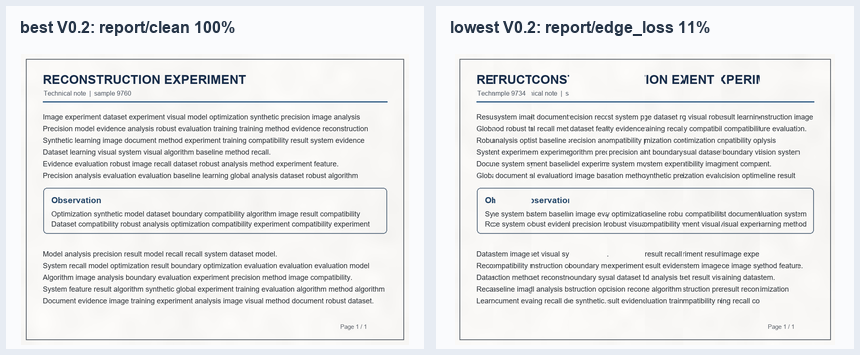

# Automatic Reconstruction of Shredded Documents

《机器学习导论》Final Project：**基于局部特征学习与全局优化的碎纸文档自动重建**。

程序生成文字、表格和简单图文混排的文档，将其切成竖直纸条并打乱；重建器只读取打乱后的像素，根据局部接缝兼容度和全局路径优化预测纸条顺序。真实顺序仅在训练标注和预测完成后的评测中使用。

V0.2 在 V0.1 的端到端流程上加入了受控的扫描干扰、边缘丢失和上下错位，并用固定的文档级训练/验证/测试划分进行评估。



左图是自动选出的最高分案例；右图是最低分案例，保留其拼接错误而没有美化结果。

## 已实现功能

- 四种合成文档：`report`、`table`、`mixed`、`sparse`。
- 8–12 条竖直纸条，随机打乱后进行端到端恢复。
- 传统局部特征（接缝、线性外推、梯度、墨迹轮廓）与 scikit-learn 逻辑回归兼容度模型。
- Held–Karp 精确全局路径优化；不读取正确顺序作为预测输入。
- 可复现的观测条件：`clean`、`no_assists`（无边框/纹理）、`scan`（亮度、模糊、逐条亮度）、`edge_loss`（0–2 px 永久边缘丢失）、`vertical_shift`（±3 px 非循环上下错位）。
- V0.2 改进方法：对局部接缝尝试有限的上下对齐，但只有相对零偏移有足够强的无标签视觉改善时才采用，避免把干净页的随机纹理误判为错位。
- CLI、Streamlit 演示、自动测试和完整的 CSV/JSON 实验记录。

## V0.2 固定实验

实验按**原始文档身份**（`variant:seed`）切分，而不是按扰动图像切分：训练 36 个文档族、验证 12 个、最终测试 48 个文档族。每个最终测试文档族派生 5 种条件，共 240 个测试案例；训练、验证、测试身份集合自动检查为不相交。

指标含义：

- **文档平均相邻率**：先对每张文档计算正确相邻关系比例，再平均，每张文档权重相同。
- **汇总相邻率**：把所有案例的正确相邻关系数相加后除以全部相邻关系数，12 条纸带案例权重稍大。
- **完整恢复率**：整张文档的纸条顺序完全正确的比例。

| 方法 | 文档平均相邻率 | 汇总相邻率 | 完整恢复率 | 平均重建时间 |
| --- | ---: | ---: | ---: | ---: |
| V0.1 传统基线 | 73.24% | 73.15% | 40.00% | 0.126 s |
| V0.1 学习兼容度 | 68.50% | 68.89% | 31.25% | 0.128 s |
| **V0.2 对齐传统基线** | **78.28%** | **78.33%** | **45.00%** | 0.379 s |
| V0.2 训练集学习兼容度 | 69.79% | 69.91% | 33.75% | 0.128 s |

V0.2 对齐方法比 V0.1 传统基线提高 **5.04 个百分点**的文档平均相邻率。在 `vertical_shift` 条件下，从 **50.49%** 升至 **75.70%**（+25.22 个百分点），完整恢复率从 18.75% 升至 43.75%；在干净条件下两者都为 96.73%，没有下降。它对边缘丢失和无辅助线索没有改善，这符合改进只针对上下错位的设计。

学习模型在此小型合成数据设置中没有稳定超过传统方法；这是保留的真实对比结果，而非删除不利方法。`sparse` 文档的大块空白、`edge_loss` 的不可恢复像素信息，以及无边框/纹理时的起止方向歧义，仍是主要失败来源。

完整可复现记录在 [`artifacts/v0.2/evaluation.json`](artifacts/v0.2/evaluation.json)、[`artifacts/v0.2/evaluation.csv`](artifacts/v0.2/evaluation.csv) 和 [`artifacts/v0.2/validation.jsonl`](artifacts/v0.2/validation.jsonl)。成功与失败四宫格分别为 [`success-case-report-8-clean-5100.png`](artifacts/v0.2/success-case-report-8-clean-5100.png) 与 [`failure-case-report-10-edge_loss-5101.png`](artifacts/v0.2/failure-case-report-10-edge_loss-5101.png)。

### 与 V0.1 的关系

V0.1 的原始工件保持在 `artifacts/v0.1/`，没有被覆盖。原有 8 张干净文档的记录是：传统基线 92.42% 相邻率、6/8 完整恢复；学习兼容度 96.59%、7/8 完整恢复。V0.2 的历史复查仍得到同一 V0.1 学习模型 96.59% 文档平均相邻率和 7/8 完整恢复。

## 安装

需要 Python 3.10+；项目不下载预训练模型、不需要 GPU，也不依赖付费 API。

```powershell
python -m venv .venv
.\.venv\Scripts\python.exe -m pip install -r requirements.txt
```

Linux / WSL2：

```bash
python3 -m venv .venv
./.venv/bin/python -m pip install -r requirements.txt
```

## 运行

### CLI 演示

```powershell
.\.venv\Scripts\python.exe -m shredded_reconstruction.demo `
  --variant mixed --strips 10 --condition vertical_shift --method learned-v0.2 `
  --seed 2026 --shuffle-seed 73
```

可选方法：`baseline`、`learned-v0.1`、`learned-v0.2`。结果写入被 Git 忽略的 `outputs/demo/`。

### Streamlit 演示

```powershell
.\.venv\Scripts\python.exe -m streamlit run app.py
```

侧边栏可选文档类型、纸条数、扰动条件和重建方法。页面显示原始文档、打乱纸条、重建图、预测顺序与真实顺序的对比指标。

### 测试与完整评测

```powershell
.\.venv\Scripts\python.exe -m pytest -q
.\.venv\Scripts\python.exe scripts\run_evaluation.py --output-dir artifacts\v0.2
```

## 项目结构

```text
shredded_reconstruction/
  document.py       合成文档与可开关边框/纹理
  shred.py          切条、打乱、可复现干扰
  conditions.py     五种固定观测条件
  features.py       局部兼容特征与有限上下对齐
  baseline.py       传统兼容度方法
  learned.py        scikit-learn 学习兼容度
  optimizer.py      精确全局排序
  splits.py         文档级 train/validation/test 切分
  evaluation.py     端到端流程与指标
scripts/run_evaluation.py  固定评测与工件保存
tests/                       单元和端到端测试
artifacts/v0.1/             V0.1 原始记录（保留）
artifacts/v0.2/             V0.2 正式结果
```

## 当前限制与下一步

- 仅处理同一页、无旋转、无重叠的竖直纸条；精确全局优化目前限于 16 条以内。
- 无边框/无纹理时，首尾方向仍存在全局歧义；边缘丢失时无法要求逐像素恢复。
- 下一版最有价值的方向是：用训练/验证集设计更可靠的起止纸条证据，或训练对边缘丢失更鲁棒的兼容度模型，并加入真实扫描文档的小规模、人工标注验证。

## License

MIT
