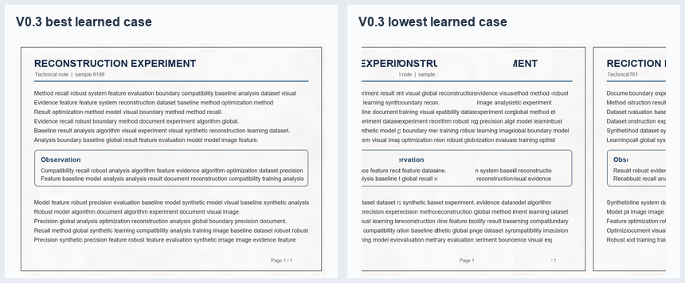
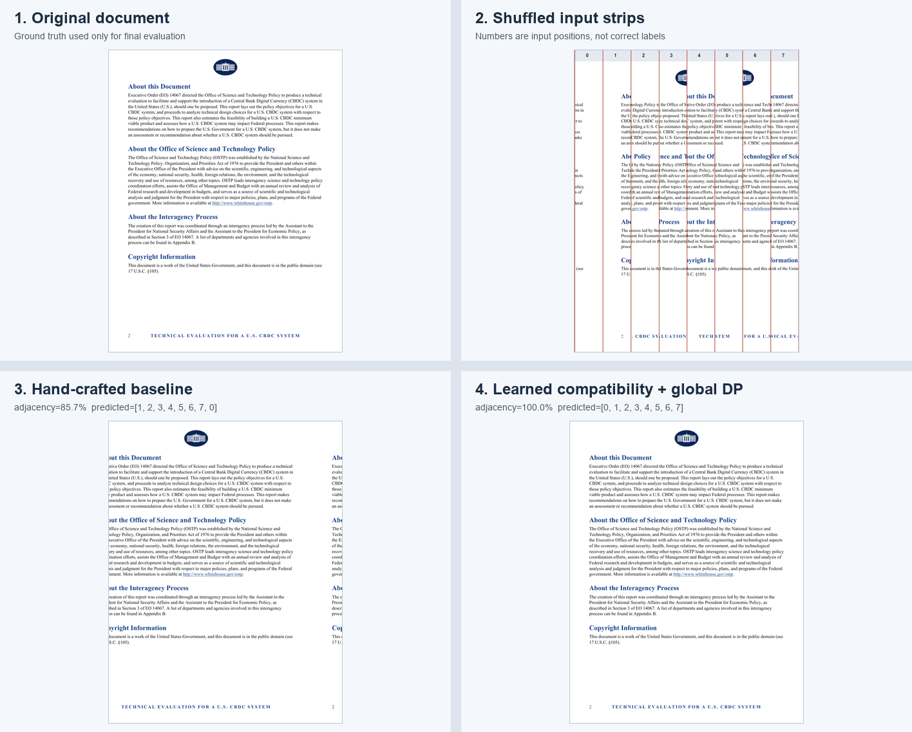
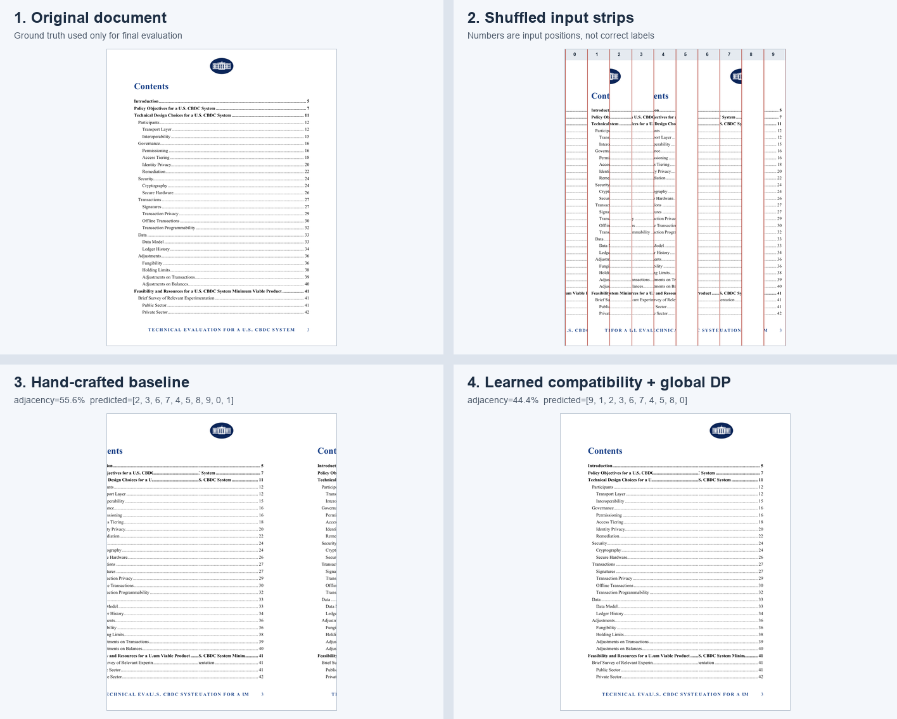

# Automatic Reconstruction of Shredded Documents

《机器学习导论》Final Project：**基于局部特征学习与全局优化的碎纸文档自动重建**。

程序将完整页面模拟切成 8、10 或 12 条竖直纸条并随机打乱；重建器只读取打乱后的像素，正确顺序仅用于训练标签和预测后的评测。

> 当前是规则竖直纸条的研究原型，不等同于物理碎纸扫描恢复；不处理旋转、重叠、任意碎片形状或缺失纸片。



## V0.3 结果摘要

V0.3 使用新的按原始文档身份隔离的训练/验证/最终测试划分（各 24 个文档族）。最终测试含 24 × 5 = 120 个合成观察案例；模型选择只看验证集。

| 方法 | 文档平均相邻恢复率 | 汇总相邻恢复率 | 完整恢复率 | 平均单页耗时 |
| --- | ---: | ---: | ---: | ---: |
| 传统 V0.2（有限上下对齐） | 80.19% | 80.19% | 47.50% | 0.490 s |
| 学习 V0.2（干净训练、无对齐） | 73.17% | 73.33% | 38.33% | 0.158 s |
| **学习 V0.3（增强 + 对齐特征）** | **84.84%** | **84.72%** | **55.00%** | **0.493 s** |

V0.3 相对传统 V0.2 提高 **4.64 个百分点**，相对 V0.2 学习模型提高 **11.67 个百分点**。它并非在所有条件都更好：`clean` 下为 94.04%，低于 V0.2 学习的 95.94%；`edge_loss` 下为 66.99%，也低于 V0.2 学习的 70.35%；`vertical_shift` 下为 74.31%，仍低于传统 V0.2 的 85.84%。真实逐案例数据和失败案例均在 [`artifacts/v0.3/`](artifacts/v0.3/)。

最大改善来自 `no_assists`：V0.3 的相邻恢复率为 89.98%、完整恢复率为 62.5%，传统 V0.2 的完整恢复率为 0%。验证集在端点权重 0.0 与 0.8 的候选中选择了 **0.0**，减少对合成边框/纹理先验的依赖；详见 [`model_selection.json`](artifacts/v0.3/model_selection.json)。

### 外部页面测试

外部测试使用两份 GovInfo 公开美国政府报告，各渲染 5 个真实 PDF 页面，共 10 页。它们**从未进入训练或验证集**；程序对这些完整页进行模拟竖切和打乱，不能把结果称为物理碎纸扫描实验。

| 方法 | 文档平均相邻恢复率 | 完整恢复率 |
| --- | ---: | ---: |
| 传统 V0.2 | 77.99% | 0% |
| 学习 V0.2 | 83.98% | 0% |
| **学习 V0.3** | **93.54%** | **80%** |

来源、页码、SHA-256 与许可说明见 [`external_sources.json`](artifacts/v0.3/external/external_sources.json)。两份 PDF 均明确标注为美国政府作品、依据 17 U.S.C. §105 属公共领域：

- [Technical Evaluation for a U.S. CBDC System (OSTP, 2022)](https://www.govinfo.gov/content/pkg/GOVPUB-PREX23-PURL-gpo193426/pdf/GOVPUB-PREX23-PURL-gpo193426.pdf)
- [Blueprint for an AI Bill of Rights (OSTP, 2022)](https://www.govinfo.gov/content/pkg/GOVPUB-PREX23-PURL-gpo193638/pdf/GOVPUB-PREX23-PURL-gpo193638.pdf)





## 方法

1. **传统 V0.2**：接缝像素差、线性外推、梯度和边缘轮廓等人工特征；对每对纸条尝试有限、非循环的上下对齐；再用 Held–Karp 动态规划找全局排列。
2. **学习 V0.2**：以相同局部特征训练 scikit-learn Logistic Regression，但只见过干净合成页且不搜索上下偏移。
3. **学习 V0.3**：仍是轻量 scikit-learn Logistic Regression；训练文档族轮换覆盖五种观察条件，特征额外包含无标签的对齐收益、偏移大小和有效重叠比例，并以验证集选择端点权重。正确纸条顺序不进入推理过程。

V0.2 学习法落后主要因为训练/测试分布不一致、没有对齐能力，且端点项容易利用合成边框线索。V0.3 解决前两项并在验证集上删除端点先验；永久边缘缺失和弱纹理空白区仍然困难。

## 安装

需要 Python 3.10+。项目不下载预训练模型、不需要 GPU，也不调用付费 API。

```powershell
python -m venv .venv
.\.venv\Scripts\python.exe -m pip install -r requirements.txt
```

## 运行

### 命令行演示

```powershell
.\.venv\Scripts\python.exe -m shredded_reconstruction.demo `
  --variant mixed --strips 10 --condition vertical_shift `
  --method learned-v0.3 --seed 2026 --shuffle-seed 73
```

方法名与实现一一对应：`traditional-v0.1`、`traditional-v0.2`、`learned-v0.1`、`learned-v0.2`、`learned-v0.3`。结果写入 Git 忽略的 `outputs/demo/`。

### Streamlit 课堂演示

```powershell
.\.venv\Scripts\python.exe -m streamlit run app.py
```

页面提供一键成功/失败示例、合成随机测试、传统 V0.2 与学习模型对照，以及上传 PNG/JPG 文档页。上传页也会先切条和打乱；真实顺序只用于最终可视化指标，绝不作为预测输入。

### 重跑正式评测

```powershell
.\.venv\Scripts\python.exe scripts\run_v03_evaluation.py --output-dir artifacts\v0.3
```

网络可用时脚本下载两份上述公共领域 PDF 到 Git 忽略的 `.tmp/` 缓存；页面与实验工件保存到 `artifacts/v0.3/`，不会覆盖 V0.1/V0.2。

## 测试

```powershell
.\.venv\Scripts\python.exe -m pytest -q
```

测试覆盖裁切/打乱、无干扰兼容性、扰动可复现性、非循环上下移动、预测排列合法性、文档级数据隔离、全局优化器与 Streamlit 示例页。

## 目录

```text
shredded_reconstruction/
  document.py       合成文档
  shred.py          切条、打乱和受控扰动
  features.py       V0.1/V0.2 与 V0.3 局部兼容度特征
  baseline.py       传统兼容度方法
  learned.py        scikit-learn 学习兼容度模型
  optimizer.py      Held–Karp 全局排列优化
  external.py       外部公开页面下载、渲染和来源记录
  v03_splits.py     V0.3 文档族训练/验证/最终测试划分
scripts/run_v03_evaluation.py  固定评测、选参与外部页面测试
artifacts/v0.1/               保留的历史记录
artifacts/v0.2/               保留的历史记录
artifacts/v0.3/               V0.3 CSV、JSON、页面、成功和失败案例
```

## 下一步

- 对真实物理碎纸扫描建立带人工标注的小规模数据集；不要把模拟裁切冒充为物理实验。
- 针对边缘缺失设计更鲁棒的局部表示，并研究首尾方向不确定时的全局建模。
- 扩展到旋转、重叠与不规则碎片之前，先保持可复现的外部页面基准。

## License

MIT
