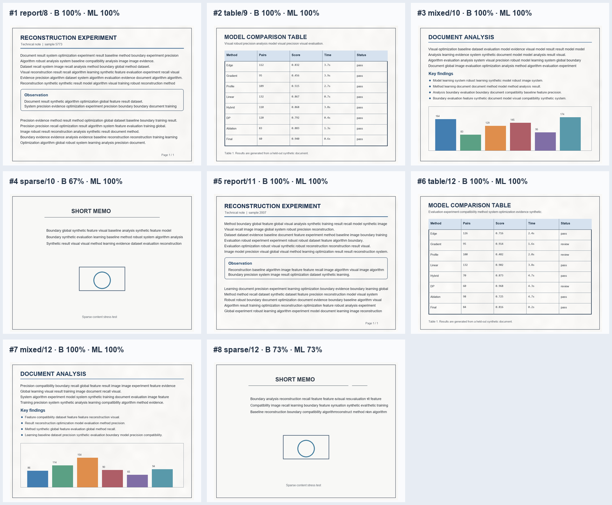
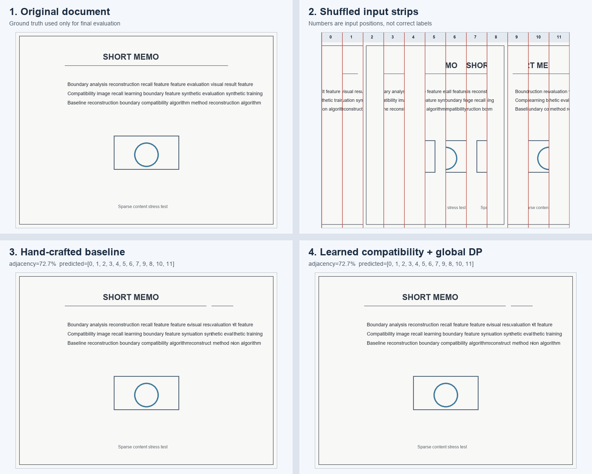

# Automatic Reconstruction of Shredded Documents

**基于局部特征学习与全局优化的碎纸文档自动重建**

这是《机器学习导论》Final Project 的 V0.1：自动生成文档，将它切成 8～12 条竖直纸条并打乱，再仅根据纸条图像预测排列顺序，最后输出恢复图像和真实评测结果。

V0.1 不使用付费 API，也不需要 GPU。真实顺序不会传入重建算法，只在预测完成后计算指标。



## 已实现功能

- 生成 `report`、`table`、`mixed`、`sparse` 四类合成文档。
- 将文档切成 8～12 条宽度近似相同的竖直纸条并随机打乱。
- 手工边缘兼容度：比较接缝误差、梯度延续、墨迹轮廓等局部信息。
- 学习型兼容度：用 scikit-learn 逻辑回归学习“左右两条是否相邻”。
- 全局优化：使用 Held–Karp 动态规划求最小代价 Hamilton 路径，而不是逐条贪心拼接。
- CLI 演示、Streamlit 页面、批量留出评测和自动化测试。
- 保存原图、打乱输入、两种重建结果、预测顺序和指标。

## V0.1 真实结果

训练集包含 24 张合成文档，固定评测集包含另外 8 张文档；文档种子完全不重叠。评测结果保存在 [`artifacts/v0.1/evaluation.json`](artifacts/v0.1/evaluation.json)，每一个案例的完整四宫格都保留在同一目录，没有只选择成功案例。

| 方法 | 平均相邻准确率 | 完整顺序正确 |
| --- | ---: | ---: |
| 手工边缘兼容度 + 全局优化 | 92.42% | 6 / 8 |
| 学习型兼容度 + 全局优化 | 96.59% | 7 / 8 |

普通的报告、表格和图文混排文档在本次固定评测中全部恢复正确。主要失败来自无纸张纹理、大片空白的 `sparse/12` 压力测试：第 8、9 条纸条在局部视觉上高度相似，两种方法都把它们交换了。



这些数字只描述当前合成数据上的 8 个固定案例，不代表真实碎纸文件上的泛化能力。

## 方法概览

```text
document image
    -> vertical cutting and shuffle
    -> feature vector for every directed strip pair
    -> hand-crafted cost OR learned adjacency probability
    -> exact global path optimization
    -> reconstructed image
    -> evaluation with hidden ground-truth order
```

学习模型的输入只有两条候选纸条边缘的像素特征。训练标签表示它们在训练文档中是否真实相邻。测试文档的真实顺序不会进入特征、模型或全局优化器。

## 安装

需要 Python 3.10 或以上。

### Windows PowerShell

```powershell
python -m venv .venv
.\.venv\Scripts\python.exe -m pip install -r requirements.txt
```

### Linux / WSL2

```bash
python3 -m venv .venv
./.venv/bin/python -m pip install -r requirements.txt
```

依赖包括 NumPy、Pillow、scikit-learn、Streamlit 和 pytest；不包含模型权重或云端服务。

## 运行 CLI 演示

Windows：

```powershell
.\.venv\Scripts\python.exe -m shredded_reconstruction.demo `
  --variant mixed --strips 10 --seed 2026 --shuffle-seed 73
```

Linux / WSL2：

```bash
./.venv/bin/python -m shredded_reconstruction.demo \
  --variant mixed --strips 10 --seed 2026 --shuffle-seed 73
```

结果写入 `outputs/demo/`：

- `original.png`
- `shuffled.png`
- `baseline-reconstruction.png`
- `learned-reconstruction.png`
- `comparison.png`
- `metrics.json`

如只想运行不训练模型的快速基线，可加 `--baseline-only`。

## 启动 Streamlit

```powershell
.\.venv\Scripts\python.exe -m streamlit run app.py
```

在侧栏选择文档类型、纸条数量和随机种子，点击 **Generate and reconstruct** 即可看到完整过程。

## 测试与复现实验

```powershell
.\.venv\Scripts\python.exe -m pytest -q
.\.venv\Scripts\python.exe scripts\run_evaluation.py --output-dir outputs\evaluation
```

评测脚本使用固定的 8 个留出文档，保存全部案例的图像、CSV 和 JSON 汇总。

## 项目结构

```text
shredded_reconstruction/
  document.py       合成文档
  shred.py          裁切、打乱和拼接
  features.py       局部边缘特征
  baseline.py       手工兼容度
  learned.py        scikit-learn 兼容度模型
  optimizer.py      精确全局排序
  evaluation.py     端到端流程和指标
  visualize.py      对比图
  demo.py           CLI 演示
scripts/
  run_evaluation.py 固定留出评测
tests/               单元和端到端测试
artifacts/v0.1/      V0.1 的完整可复现证据
app.py               Streamlit 页面
```

## 当前限制

- 只处理同一张文档的竖直、朝向一致、无重叠纸条。
- 当前文档都是程序生成的，尚未验证扫描件、照片、弯曲或缺损碎纸。
- 大片空白会产生多个视觉上几乎等价的排序；全局优化无法凭空恢复不存在的线索。
- 学习模型只是逻辑回归，不会直接学习深层图像表示。
- 精确动态规划随纸条数指数增长，V0.1 将范围限制为 8～12 条。

## 下一步候选方向

1. 加入扫描噪声、亮度变化、裁切缺口和轻微上下错位。
2. 使用专门的边缘图像编码器学习兼容度，并严格按文档划分训练/验证/测试集。
3. 增加真实文档上传、置信度可视化和人工修正功能。
4. 为更多纸条改用 beam search、整数规划或分层优化。

## License

MIT
